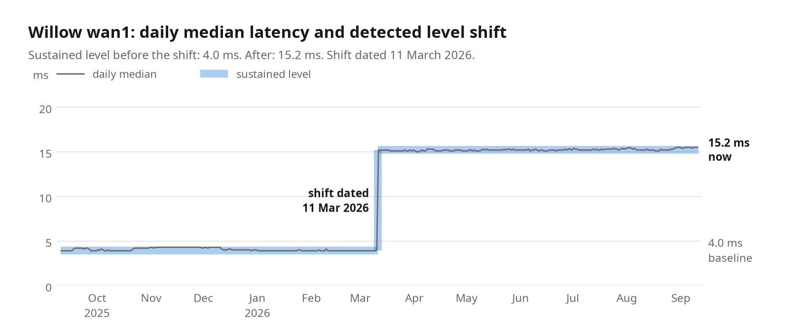

# Meraki Tools

**Small scripts for running Cisco Meraki networks through the Dashboard API. Each one does a single job and stands on its own.**

## The tools

<table>
  <tr>
    <td width="46%">
      <a href="wan-stats/README.md">
        <picture>
          <source media="(prefers-color-scheme: dark)" srcset="wan-stats/docs/img/worse-willow-dark.png">
          
        </picture>
      </a>
    </td>
    <td>
      <h3><a href="wan-stats/README.md">WAN stats</a></h3>
      Data science for WAN links. A cron job keeps a history of loss and latency for every uplink, and statistics, not fixed alarms, find the links whose latency jumped or crept. It also counts every outage. Reports as a Jupyter notebook, a PDF, or plain text in a terminal. Stores to SQLite by default, or to PostgreSQL or MongoDB. Read-only.
    </td>
  </tr>
</table>

More tools will be added here. Each gets its own folder, with its own README, requirements and tests.

## Getting started

The tools are Python scripts, so there is nothing to build. Clone the repository and follow the README in the tool's folder:

```sh
git clone https://github.com/egrisdev/meraki-tools.git
cd meraki-tools/wan-stats
```

## What they share

Every tool reads the Meraki API key the same way: from the `MERAKI_API_KEY` environment variable, or from a `.env` file that git ignores. Nothing else is shared between them, so you can copy one folder and leave the rest.

Each tool's README says whether it only reads from Meraki or also makes changes.

## Disclaimer

Meraki Tools is a free, unofficial, community project. It is provided **"as is", without warranty of any kind**, and the authors accept **no liability** for any damage, data loss, outage or other harm that comes from using it (see the [license](LICENSE)). Review the code and test it before relying on it, and follow your organization's change and security policies.

Cisco and Meraki are trademarks of Cisco Systems, Inc. They are used here only to describe compatibility. Meraki Tools is not affiliated with or endorsed by Cisco.

## License

Meraki Tools is released under the [MIT License](LICENSE): anyone may use, copy, modify and distribute it, commercially or not, for any purpose. The only condition is keeping the copyright and license notice.
